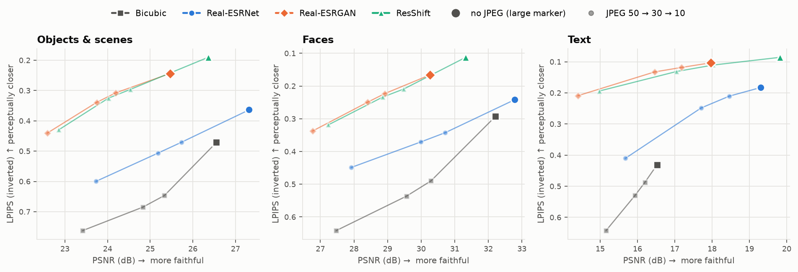
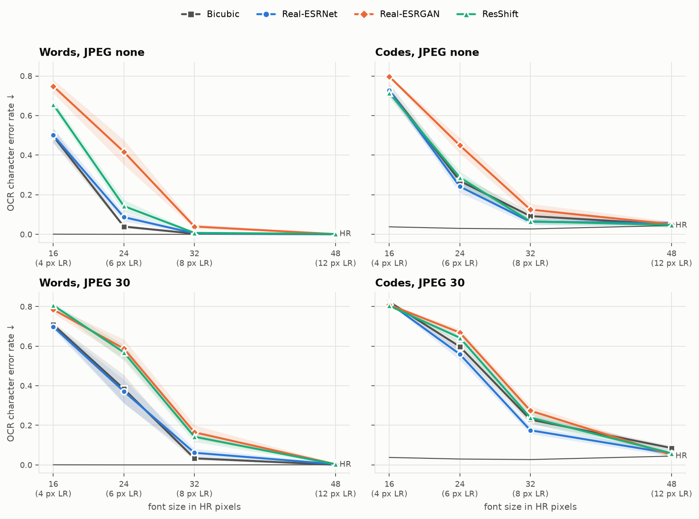
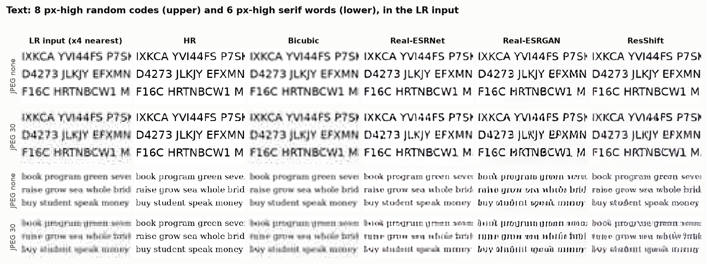
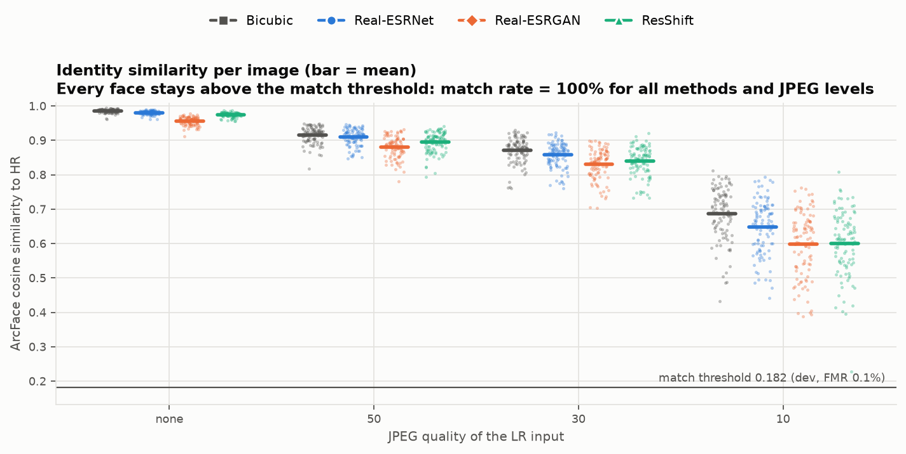
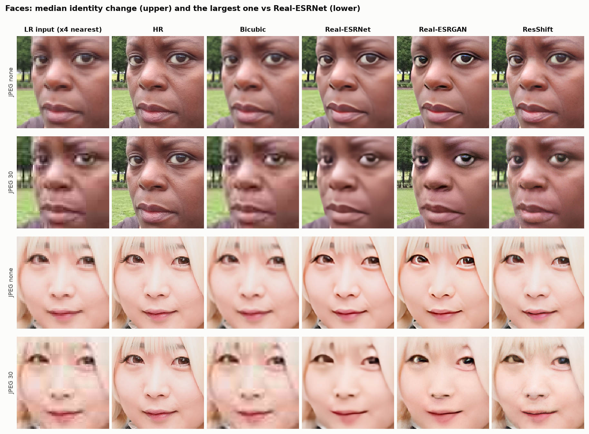
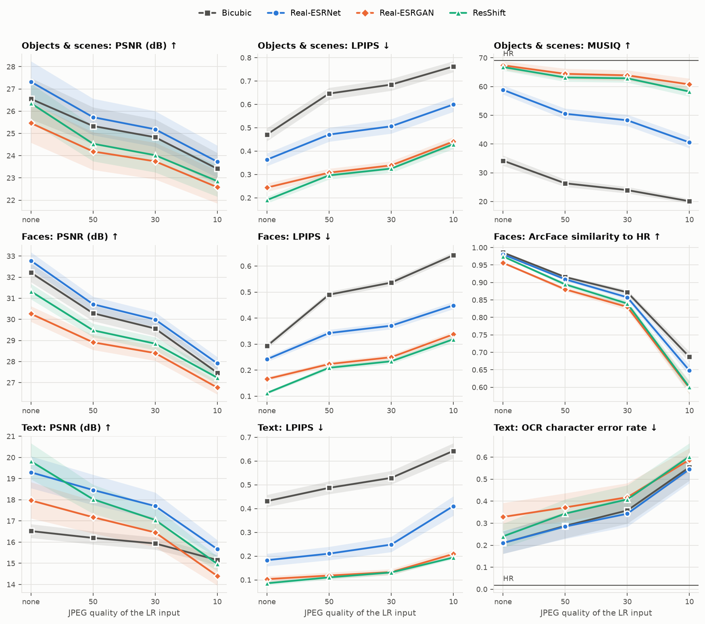
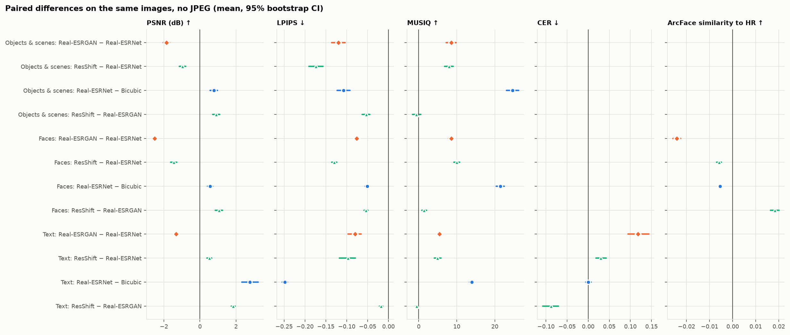
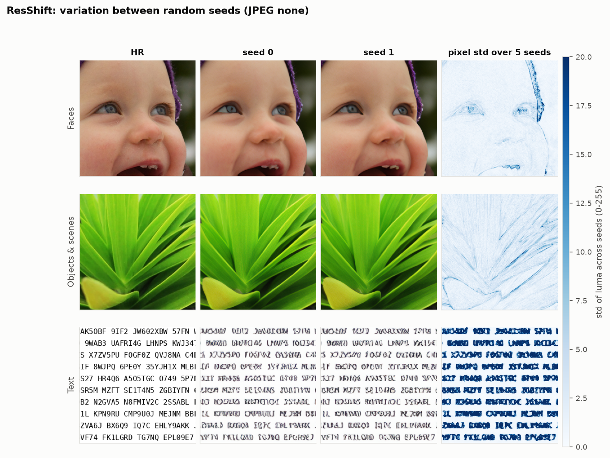

# Image Super-Resolution with Deep Generative Models

**Computer Vision 2026.** Team: Julia Kurnaeva, Alena Petrenko, Amaliya Kharisova, Dmitrii Kuznetsov

> **Question.** How much fidelity (accuracy, correctness) do pretrained generative ×4
> super-resolution models give up for perceptual quality, compared with a non-generative
> baseline? How does this depend on image content (text, faces, objects) and on JPEG
> compression strength?
>
> **Hypothesis.** Generative models look sharper but score lower on PSNR, invent letters
> on text and alter identity on faces; all models degrade sharply below JPEG quality 30,
> which is outside their training range (30–95).

All models are pretrained and evaluated zero-shot. Nothing is trained.

## Results (test split: 276 images × 4 JPEG levels, run once)

Full tables: [`results/summary.md`](results/summary.md). Per-image metrics: `results/metrics/test/`.
All numbers are means with 95% bootstrap CIs over images. "Δ" is a **paired** difference on the same images.

**Short answer.** Generative training costs 1.3–2.5 dB PSNR. The cleanest measure is Real-ESRGAN − Real-ESRNet:
same network, same training data, only the loss differs. In exchange, LPIPS improves by 0.08–0.12 and MUSIQ
by 5–9 points. The price depends on the generative model. ResShift beats Real-ESRGAN on *both* axes: higher
PSNR **and** lower LPIPS. Against Real-ESRNet it gives up 1.0–1.5 dB on photos and nothing on text. What
generative training costs is correctness. Real-ESRGAN makes 56% more OCR errors than Real-ESRNet, almost
all of them confident wrong letters. The generative models also move faces measurably away from the true
identity (ArcFace), though never far enough to fail face verification.



### Hypotheses

| hypothesis | verdict | evidence (no JPEG unless stated) |
|---|---|---|
| Generative models look sharper but score lower on PSNR | **Supported for Real-ESRGAN; partly for ResShift** | ESRGAN − ESRNet: ΔPSNR −1.86 ± 0.17 dB (objects), −2.52 ± 0.14 (faces), −1.33 ± 0.12 (text); ΔLPIPS −0.12 / −0.08 / −0.08; ΔMUSIQ +8.5 / +8.6 / +5.5. ResShift − ESRNet: ΔPSNR −0.96 (objects), −1.45 (faces) but **+0.52 dB on text**, with the best LPIPS everywhere. |
| … invent letters on text | **Supported, strongly for Real-ESRGAN** | CER 0.328 (ESRGAN) vs 0.210 (ESRNet), Δ +0.118 ± 0.025. The extra errors are substitutions: on dictionary words, 21.6% of characters are replaced vs 10.7%. ResShift: Δ +0.030 ± 0.012. Sharpening without a GAN does not help OCR at all (ESRNet − Bicubic: Δ +0.001 ± 0.007). |
| … alter identity on faces | **Partly supported** | ArcFace similarity to HR drops with generative training at every JPEG level: ESRGAN − ESRNet −0.024 ± 0.002, ResShift − ESRNet −0.006 ± 0.001. Bicubic keeps identity best (0.986). But no face crosses the dev match threshold (FMR 0.1%): the match rate is 100% for all methods and levels, and the lowest same-person similarity is 0.23 (ResShift, JPEG 10). Identity *drifts*; it is not *swapped* at this operating point. |
| All models degrade sharply below JPEG 30 (outside the 30–95 training range) | **Degradation accelerates, but not because of the training range** | For every method × content × metric, the loss from JPEG 30→10 is 2.0–5.3× the loss from 50→30, the same 20-point step (all 32 paired CIs exclude 0). Bicubic, which has no training range, accelerates just as much (PSNR 2.8×), so the cliff comes mostly from JPEG itself. What *is* model-specific: generative models keep looking good while fidelity collapses. MUSIQ on objects, JPEG none→10: ESRGAN 67→61, ResShift 67→58, ESRNet 59→41. |

### Objects & scenes (80 images)

| method | PSNR ↑ | SSIM ↑ | LPIPS ↓ | MUSIQ ↑ |
|---|---|---|---|---|
| HR | – | – | – | 69.1 ± 1.5 |
| Bicubic | 26.55 ± 0.93 | 0.713 | 0.471 | 34.2 |
| Real-ESRNet | **27.32** ± 0.91 | **0.759** | 0.364 | 58.9 |
| Real-ESRGAN | 25.46 ± 0.90 | 0.701 | 0.244 | **67.4** |
| ResShift | 26.36 ± 0.86 | 0.724 | **0.190** | 66.8 |

### Text (96 images): the font-size effect



The danger zone is **letters 6 px tall in the input** (24 px in HR). At 4 px nothing is readable. At 12 px
every method reads like HR. At 6 px there is partial evidence, and a GAN fills the gap with plausible glyphs.
Word CER at 6 px: Bicubic 0.04, Real-ESRNet 0.09, ResShift 0.14, **Real-ESRGAN 0.42**. Random codes, which have
no language prior, show the same Real-ESRGAN penalty (Bicubic 0.27, ESRNet 0.24, ResShift 0.29, ESRGAN 0.45).



### Faces (100 images)

| method | PSNR ↑ | LPIPS ↓ | MUSIQ ↑ | ArcFace sim (none) ↑ | ArcFace sim (JPEG 10) ↑ |
|---|---|---|---|---|---|
| Bicubic | 32.21 | 0.293 | 41.5 | **0.986** | **0.687** |
| Real-ESRNet | **32.78** | 0.242 | 62.9 | 0.980 | 0.648 |
| Real-ESRGAN | 30.26 | 0.166 | 71.5 | 0.956 | 0.598 |
| ResShift | 31.33 | **0.112** | **72.9** | 0.975 | 0.600 |




At JPEG 30 the 8×8 JPEG blocks of the input are 32×32 in the output. The generative models redraw them as skin
texture and eyes. In the lower example, both give the two eyes different iris colours, although the HR eyes
match. ArcFace similarity drops, yet stays above the match threshold.

### JPEG compression



The first JPEG step already costs a lot: none → 50 loses 1.2–2.1 dB on objects and faces, more than 50 → 30.
At JPEG 10 ResShift's text CER (0.60) is the worst of all methods, and every learned model is within a few
points of bicubic. Under heavy compression the learned priors no longer help reading.

### Paired contrasts



### ResShift: random seeds

Five seeds on 30 test images ([`results/seed_experiment/summary.md`](results/seed_experiment/summary.md)).
Outputs differ by 2.6–7.1 grey levels per pixel (std), concentrated on edges and letters. Between seeds, the
per-image PSNR varies by only 0.10–0.26 dB, face similarity by 0.003–0.016 and CER by ~0.01. No face match
decision flips. This per-image seed noise is 5–10× smaller than the between-method gaps and averages out
further over 80–100 images, so the single-seed results above are stable.



### Cost

| method | s / image, 128→512 (Apple M4 GPU, MPS) | memory (MPS driver, MB) | NVIDIA T4 |
|---|---|---|---|
| Bicubic | 0.006 | – | run `notebooks/t4_runtime.ipynb` |
| Real-ESRNet | 0.25 | 1,120 | |
| Real-ESRGAN | 0.25 | 1,120 | |
| ResShift (4 steps, fp16) | 3.05 | 6,284 | |

ResShift is 12× slower than the GAN for a better perception–distortion trade-off.


---

## Contents

- [Setup](#setup)
- [Reproducing the results](#reproducing-the-results)
- [Protocol](#protocol)
- [Repository layout](#repository-layout)
- [Division of work](#division-of-work)
- [Deviations from the plan and limitations](#deviations-from-the-plan-and-limitations)
- [Credits and licences](#credits-and-licences)

## Setup

Python 3.10+ and [Tesseract](https://github.com/tesseract-ocr/tesseract) 5 (`brew install tesseract` or
`apt-get install tesseract-ocr`).

```bash
python -m venv .venv && source .venv/bin/activate
pip install -e ".[dev]"                 # or: pip install -r requirements.lock.txt && pip install -e . --no-deps
bash scripts/setup_third_party.sh       # official ResShift code, pinned commit
```

`requirements.lock.txt` pins the exact versions of the reported run (Python 3.11, torch 2.14).
The code picks CUDA, then Apple MPS, then CPU (`--device` overrides this).

## Reproducing the results

| step | command | what it does | time (M4, MPS) |
|---|---|---|---|
| 1 | `python scripts/download.py` | DIV2K valid HR (449 MB), 120 FFHQ images, 4 checkpoints | ~10 min |
| 2 | `python scripts/prepare_data.py` | HR crops, synthetic text, split, LR + JPEG inputs | 1 min |
| – | `make check` | unit tests; Set5 check of the bicubic/PSNR protocol | 10 s |
| 3 | `python scripts/run_sr.py --split dev` | 4 methods × 64 images × 4 JPEG levels | 15 min |
| 4 | `python scripts/tune_dev.py` | choose settings on dev → `configs/frozen.yaml` | 15 min |
| 5 | `python scripts/run_sr.py --split test` | **once**, with the frozen settings | 60 min |
| 6 | `python scripts/evaluate.py --split test` | per-image metrics → `results/metrics/test/` | 30 min |
| 7 | `python scripts/seed_experiment.py` | ResShift under 5 seeds on a test subset | 20 min |
| 8 | `python scripts/benchmark_runtime.py` | seconds / image and peak memory | 5 min |
| 9 | `python scripts/analyze.py` | tables, figures, `results/summary.md` | 1 min |

`make all` runs everything in order. Every step is resumable (existing outputs are skipped).
Cost on the **NVIDIA T4** comes from [`notebooks/t4_runtime.ipynb`](notebooks/t4_runtime.ipynb)
(Colab/Kaggle). It writes `results/runtime/Tesla_T4.csv`, which step 9 picks up.

**Test split run once.** `run_sr.py --split test` refuses to start without
`configs/frozen.yaml`. It records each method's run in `outputs/test_runs.json` together
with the config hash. Re-running a finished method, or running with changed settings, is
refused unless `--force` is given.

## Protocol

### Data (340 images, 512×512 HR)

| content | source | test | dev | why |
|---|---|---|---|---|
| Objects & scenes | DIV2K validation 0801–0900, 512×512 centre crops | 80 | 20 | standard SR benchmark; clean 2K PNGs; not in the models' training data |
| Faces | FFHQ (sampled from 00000–00999), 1024 → 512 | 100 | 20 | clean, aligned faces |
| Text | synthetic: 3 fonts (DejaVu Sans / Serif / Sans Mono) × 4 sizes (16, 24, 32, 48 px) × {dictionary words, random codes} | 96 | 24 | exact transcription for OCR; controlled letter size |

- **LR inputs.** HR → MATLAB-style bicubic ↓4 (128×128) → JPEG quality ∈ {none, 50, 30, 10}
  (libjpeg baseline, 4:2:0). The decoded JPEG is stored losslessly. **Every** image gets
  **every** JPEG level, so content and compression are not confounded.
  `scripts/validate_protocol.py` checks the resize + PSNR code on Set5 ×4: bicubic gives
  28.43 dB / 0.8113 vs the published MATLAB 28.42 / 0.8104.
- **Text.** Font sizes are HR pixels. In the 128×128 input a letter is 4, 6, 8 or 12 px tall.
  "Codes" are random A–Z/0–9 strings with no language prior. "Words" come from a fixed list of
  common English words. Dev and test text use different seeds (2002 / 1001).
- **Split** by source image with fixed seeds. `prepare_data.py` asserts that no source image is
  in both splits.
- **Leakage.** Real-ESRNet/ESRGAN were trained on DIV2K *train* + Flickr2K + OST; ResShift on
  ImageNet. None of them saw DIV2K *valid* or FFHQ.

### Methods (all pretrained)

| method | type | details |
|---|---|---|
| Bicubic | interpolation | the same MATLAB kernel that made the LR |
| Real-ESRNet x4plus | CNN, L1 loss | RRDBNet; official weights; fp16 on CUDA as in the official code |
| Real-ESRGAN x4plus | GAN | **same network and training data as Real-ESRNet**, fine-tuned with L1 + perceptual + GAN losses, so the ESRGAN − ESRNet difference isolates generative training |
| ResShift v3 | diffusion, 4 steps | official code and weights (journal version). Stochastic: per-image seed, the same noise for all JPEG levels of an image |
| SD ×4 Upscaler | diffusion (fallback) | implemented (`--methods sd_upscaler`); not needed, because ResShift ran |

ResShift's official sampler hard-codes CUDA. [`src/srbench/models/resshift.py`](src/srbench/models/resshift.py)
builds the same diffusion, Swin-UNet and VQGAN from the official config and calls the same
`p_sample_loop`, so it also runs on MPS/CPU. On MPS the noise-schedule arrays are cast to
float32, because MPS has no float64.

### Metrics

- **Fidelity:** PSNR and SSIM on the Y channel (BT.601), 4-px border crop (standard SR protocol).
- **Perceptual:** LPIPS (AlexNet, vs HR) and MUSIQ (KonIQ, no reference; pyiqa).
- **Text:** Tesseract 5 (LSTM) character error rate (Levenshtein / reference length, whitespace
  normalised), plus word error rate and a split of errors into substituted / missing / extra
  characters.
- **Faces:** ArcFace (InsightFace buffalo_l, R50 WebFace600K) cosine similarity between the SR
  output and its HR. Landmarks are detected once on the HR image and reused for every output,
  so a detector failure on a degraded image cannot pose as an identity change. Match rate =
  share of faces with similarity ≥ the dev threshold.
- **Cost:** seconds per image (batch 1, after warm-up, device-synchronised) and peak accelerator memory.
- **Statistics:** mean ± 95% percentile bootstrap CI over images (10,000 resamples). Method
  comparisons use **paired** bootstrap CIs of the per-image difference.
- **Sensitivity experiment:** the JPEG sweep. JPEG 50 → 30 and 30 → 10 are equal 20-point
  steps, so "sharp degradation below 30" is tested as a per-image paired comparison of the two losses.
- **Random-seed experiment:** ResShift with seeds 0–4 on 30 test images × JPEG {none, 30}.

### Settings chosen on dev (`configs/frozen.yaml`)

| setting | searched | chosen | dev evidence |
|---|---|---|---|
| OCR page segmentation | psm 4, 6 | **6** (uniform block) | lowest mean CER over all dev conditions |
| OCR pre-upscaling | ×1, ×2, ×3 | **×1** | same; HR text CER 1.4% |
| OCR dictionary prior | on, off | on (default) | no effect: the LSTM engine ignores the `*_dawg` switches (identical CER) |
| Face-match threshold | – | **0.182** | 99.9th percentile of 6,270 dev impostor scores (FMR 0.1%) |
| ResShift precision | fp16 autocast vs fp32 | **fp16** | LPIPS(fp16, fp32) = 0.0007, about 1% of the seed-to-seed LPIPS (0.065) |

The OCR objective weights every (method, JPEG) condition equally, so the reader is not tuned for any one method.

## Repository layout

```
configs/default.yaml       every setting; configs/frozen.yaml = defaults + dev-tuned values
src/srbench/
  data/                    download, synthetic text renderer, HR/LR/JPEG pipeline, split
  imresize.py              MATLAB-compatible bicubic resize
  models/                  common interface: bicubic, RRDBNet (ESRNet/ESRGAN), ResShift, SD fallback
  metrics/                 PSNR/SSIM, LPIPS/MUSIQ, Tesseract CER, ArcFace
  pipeline.py              resumable runner + test-split lock
  evaluate.py, stats.py    per-image metrics; bootstrap CIs and paired differences
  figures.py               all figures
scripts/                   one script per pipeline step (see the table above)
notebooks/t4_runtime.ipynb cost measurement on a T4
results/                   metrics per image, tables, figures, summary.md (tracked)
tests/                     unit tests
```

## Division of work

| role | builds | analyses and presents |
|---|---|---|
| Data | `data/` (download, degradation pipeline, text generator, splits), `validate_protocol.py` | Text (OCR, font-size effect) |
| GAN & baselines | `models/` interface, Bicubic, Real-ESRNet, Real-ESRGAN, `runtime.py`, `benchmark_runtime.py` | Objects & scenes |
| Diffusion | `models/resshift.py` (+ SD fallback), `seed_experiment.py` | Faces (identity) |
| Evaluation | `metrics/`, `stats.py`, `evaluate.py`, `figures.py`, `analyze.py`, README & reproducibility | JPEG compression |

Each member reviews one teammate's code and explains their part at the weekly sync.

## Deviations from the plan and limitations

- **Cost was measured on an Apple M4 (MPS), not on a T4.** The T4 numbers the plan asks for come from
  [`notebooks/t4_runtime.ipynb`](notebooks/t4_runtime.ipynb), which still has to be run on Colab/Kaggle
  (`results/runtime/Tesla_T4.csv` is picked up automatically). MPS has no peak-memory counter, so the MPS
  column is the driver allocation after the call (an upper bound that includes cached blocks). On CUDA the
  script reports `max_memory_allocated`.
- **All SR outputs were produced on MPS.** ResShift's noise therefore differs from a CUDA run with the same
  seed (the seed experiment shows how little that matters). Real-ESRNet/ESRGAN run in fp32 on MPS instead of
  the official fp16 on CUDA.
- **Face match rate is saturated.** At the dev-calibrated threshold (0.182, FMR 0.1% on 6,270 dev impostor
  pairs), every output matches its identity. The continuous ArcFace similarity carries the identity analysis.
  A stricter operating point would need a much larger impostor set than 20 dev identities.
- **Landmarks:** one HR face (dev `face_00359`, tilted and partly covered by a glass) was only found with a
  lower detector threshold (0.3 instead of 0.5). The FFHQ-512 template fallback was never needed.
- **OCR dictionary switch** was in the dev grid but had no effect (the LSTM engine ignores
  `load_system_dawg`/`load_freq_dawg`). The OCR reader is Tesseract's "eng" model: it reads clean HR text
  with 1.8% CER (0% on words, ~3% on codes, which have O/0 and I/1 ambiguities). So a CER above that
  reflects the image, not the reader.
- **SD ×4 Upscaler fallback** is implemented but was not run, because ResShift worked.
- **MUSIQ on text** is not meaningful as quality (it rates synthetic text pages below photos); it is reported for completeness.
- **Scope:** one degradation chain (bicubic ↓4 + JPEG, no blur/noise); 80–100 images per content, so CIs of
  ±0.2–0.9 dB on absolute PSNR (paired differences are much tighter).


## Credits and licences

- Real-ESRGAN / Real-ESRNet: X. Wang et al., ICCVW 2021, [xinntao/Real-ESRGAN](https://github.com/xinntao/Real-ESRGAN) (BSD-3).
  The RRDBNet definition follows [BasicSR](https://github.com/XPixelGroup/BasicSR) (Apache-2.0).
- ResShift: Z. Yue et al., NeurIPS 2023 / TPAMI 2024, [zsyOAOA/ResShift](https://github.com/zsyOAOA/ResShift)
  (S-Lab License 1.0, non-commercial).
- DIV2K: Agustsson & Timofte, CVPRW 2017 (academic use). FFHQ: Karras et al., CVPR 2019 (CC BY-NC-SA 4.0).
- LPIPS (Zhang et al. 2018), MUSIQ (Ke et al. 2021) via [pyiqa](https://github.com/chaofengc/IQA-PyTorch),
  ArcFace / InsightFace buffalo_l (non-commercial research use), Tesseract OCR (Apache-2.0).
